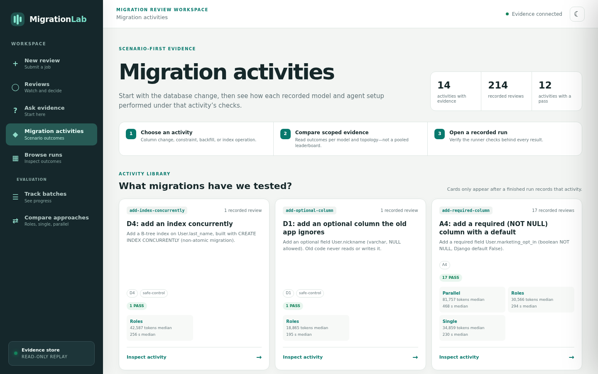
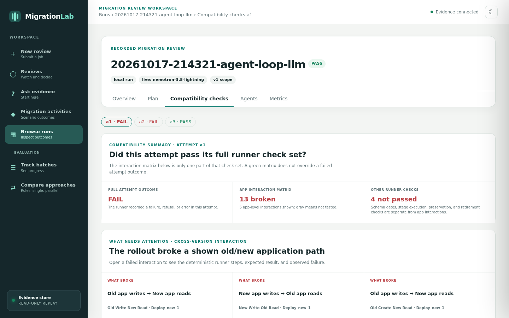
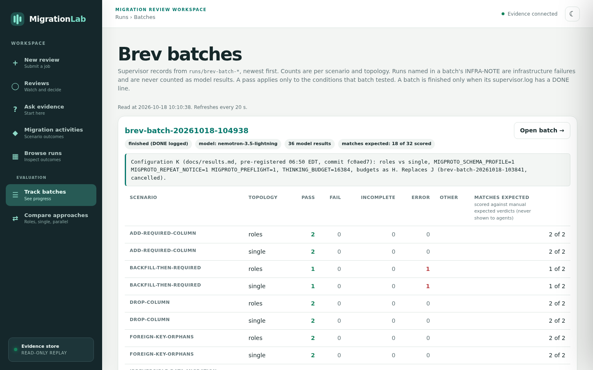
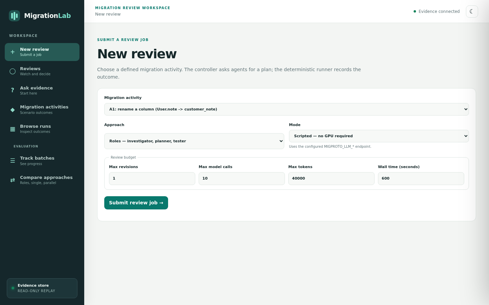
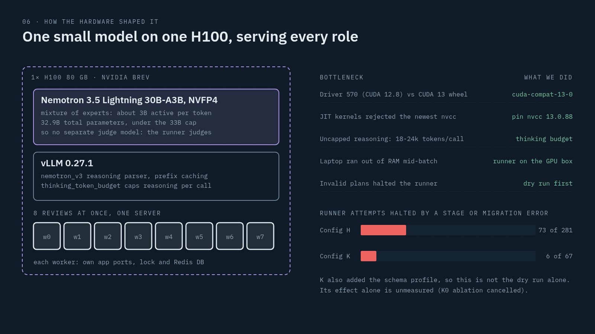
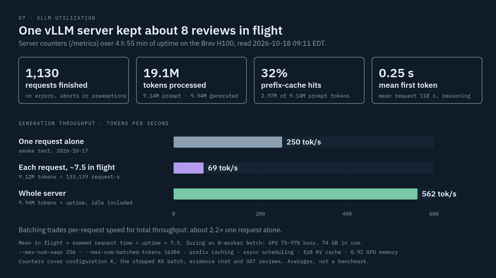

# MigrationLab: staged database migrations, reviewed by small-model agents against live old and new app versions

A schema change can pass every test and still break production: during a rolling deploy the
old app version keeps running against the new schema. MigrationLab has agents propose a
**staged** migration plan (expand, backfill, sync, deploy, retire, contract), then a
deterministic runner **executes it** against the old and the new version of a real Django app
(Saleor) sharing one disposable Postgres database. It checks every cross-version read and
write at every stage and feeds the evidence back so the agents can revise. Agents propose;
only the runner decides pass or fail.

- **Model:** NVIDIA Nemotron 3.5 Lightning (`NVIDIA-Nemotron-3.5-Lightning-30B-A3B-NVFP4`,
  32.9B total parameters counted from the checkpoint, within the event's 33B budget), one
  shared deployment for every agent role.
- **Serving:** Red Hat vLLM 0.27.1 on 1x H100 (NVIDIA Brev, event credits).
- **Evaluation environment:** a NeMo Gym resources server wraps the same runner (`gym/`).
- **Review UI:** replay any recorded review, submit new ones, add human feedback, compare
  topologies and batches.
- **Live demo (read-only):** https://migrationlab.onrender.com (all 227 recorded Lightning
  reviews and 28 Brev batches; may take up to a minute to wake).

## Screenshots

| | |
|---|---|
|  |  |
| **Migration activities:** recorded outcomes per scenario, model and topology | **Compatibility checks:** run `20261017-214321`, attempt 1 (FAIL), before the agents revised the plan |
|  |  |
| **Brev batches:** configuration K, scored against labels the agents never see | **New review:** submit a review job to the controller |

## Quick start

Prerequisites: Linux, Docker, `git`, [`uv`](https://docs.astral.sh/uv/) (provides Python
3.12), `libmagic`. Free ports: 55432 (Postgres), 56379 (Valkey), 8001/8002 (old/new app),
8765 (UI).

**See recorded evidence only (no Docker, no GPU, about 1 minute):**

```bash
uv sync
uv run migproto ui --port 8765 --db /tmp/demo.sqlite   # open http://127.0.0.1:8765/
```

The UI ingests the frozen fixtures in `examples/` and any local `runs/`.

**Run the full loop locally without a model (about 10 minutes the first time):**

```bash
uv sync
uv run migproto setup                            # Postgres + Valkey, pinned Saleor clone, old/new worktrees
uv run migproto baseline --skip-pytest           # seed template database, old-app smoke checks
uv run migproto unsafe                           # reproduce: immediate rename breaks the old app
uv run migproto agent-loop --proposals scripted  # full loop with scripted proposals: attempt 1 FAIL, attempt 2 PASS
uv run pytest                                    # unit tests (needs the local Postgres for trigger tests)
```

**Run a live review with a model** (any OpenAI-compatible endpoint; for Lightning on vLLM see
below):

```bash
set -a; source .env; set +a                      # .env is not auto-loaded; copy .env.example first
uv run migproto agent-loop --proposals llm --topology roles --scenario rename-note
```

Each command writes `runs/<timestamp>-<command>/` (`events.jsonl`, `summary.json`, plans, SQL,
server logs, agent transcripts). Exit code 0 = PASS, 1 = FAIL, 2 = ERROR.

## Architecture and tech stack






One review, step by step:

```text
review request -> investigator (searches old-version code) -> planner (staged SQL plan)
  -> tester (extra cross-version cases) -> runner: fresh database clone, old and new app side
     by side, every stage executed, mandatory checks after each stage
  -> tester summarises the evidence -> planner revises -> runner again (up to the budget)
```

| Layer | Stack |
|---|---|
| Agents | Python 3.12, plain `requests` OpenAI-compatible client, JSON-schema-validated replies; topologies `roles` (investigator, planner, tester), `single` (one agent, compacted history) and `parallel` (three planners per round); optional Langfuse tracing (viewer only) |
| Inference | vLLM 0.27.1, Nemotron 3.5 Lightning NVFP4, `nemotron_v3` reasoning parser, prefix caching, per-call thinking budget; `scripts/brev/serve_lightning.sh` |
| Runner | Django `manage.py` per app version, uvicorn servers, psycopg 3, Postgres 15, Valkey; SQL guard limited to `127.0.0.1` databases named `migproto_run_*` |
| Target app | [Saleor](https://github.com/saleor/saleor) pinned at `0c0e2697`; each scenario's old/new versions are patches in `patches/` |
| Evidence and UI | SQLite evidence store, stdlib HTTP server, vanilla JS |
| Evaluation | NeMo Gym 0.7.0 resources server (`gym/`), manual expected-outcome labels the agents never see |

**Why these choices:**
- **One small model for every role.** The 33B budget rules out a separate judge or critic, so
  the judge is the runner, which is deterministic.
- **vLLM.** One server batches up to 8 concurrent reviews on a single H100, with prefix
  caching across the roles' shared prompts.
- **Fixing problems without retraining.** When a failure pattern showed up in the runner
  records, we added a deterministic tool or pre-check instead of a bigger model. Examples:
  the backfill pre-check, the schema/data profile, and the dry run with write probe.

## Hosting the review UI (read-only)

Live at **https://migrationlab.onrender.com**. `render.yaml` is the [Render](https://render.com)
Blueprint for this public, read-only copy of the UI: in Render, **New → Blueprint**, pick
this repository, deploy. It serves the frozen fixtures in `examples/` plus
`demo/runs.tar.xz`: all 227 recorded Lightning reviews and the 28 Brev batch records,
exported by `scripts/export_demo_runs.py`. The export drops model transcripts (prompts),
trace links, server logs and serving environment files, and replaces home paths. It runs
`migproto ui --host 0.0.0.0 --read-only`, so visitors can replay runs and batches and ask the
evidence chat (recorded facts only), but cannot start reviews. Live reviews need Docker,
Postgres, the Saleor worktrees and a model endpoint, so they run locally (below).

## How to reproduce the demo

1. **Recorded demo (what the video shows):** `uv run migproto ui --port 8765 --db
   /tmp/demo.sqlite`, then follow [docs/demo-script.md](docs/demo-script.md). Every number on
   screen comes from a saved run directory.
2. **Live review on Lightning:** serve the model on a GPU, tunnel it to the runner machine,
   and set the environment:
   ```bash
   cp .env.example .env    # then edit; the code reads the process environment only
   # essential variables:
   MIGPROTO_LLM_BASE_URL=http://127.0.0.1:8000/v1
   MIGPROTO_LLM_MODEL=nemotron-3.5-lightning
   MIGPROTO_LLM_API_KEY=unused                   # vLLM started without --api-key
   MIGPROTO_LLM_THINKING_BUDGET=16384
   ```
   On a Brev H100: `bash scripts/brev/serve_lightning.sh` (about 3 minutes from a fresh
   instance; no Hugging Face token needed). To run measured batches with tunnel, budgets and
   cost stop: `scripts/brev/supervise.py`. The full procedure, including the driver/CUDA
   workarounds, is in [docs/serving.md](docs/serving.md).
3. **No API keys are required.** Langfuse keys in `.env.example` are optional (tracing off
   unless both are set). Never commit `.env`.

## Data and provenance

All data we created is published in [`dataset/`](dataset/README.md): the 245 seed rows, the 14
scenario definitions, and all 226 recorded Lightning reviews (configurations A-K, failures
included) with their 213 saved final plans. Its
datasheet explains the method, and `scripts/export_dataset.py` regenerates it.

| Data | Provenance |
|---|---|
| Customer rows (245 in `account_user`) | **Synthetic only.** 200 customers from `migproto/seed.py` (deterministic, `random.Random(42)`: word-list notes, NULLs, unicode, quotes, a 2,000-char note) plus Saleor's own `populatedb` sample data (Faker-generated) and its local dev superuser. No real personal data. Snapshot hash recorded per run (`seed:61e4e7a7f3caa544`) |
| Optional Olist seed | `baseline --seed-source olist` uses review comments from the public Kaggle "Brazilian E-Commerce Public Dataset by Olist" as note text (downloaded by the user, not committed). Not used for any reported result |
| Scenarios (14) | Written by the team in `migproto/scenarios.py`: renames, drops, type changes, constraints, foreign keys, backfills. Every schema change was **introduced on purpose**; none is an upstream Saleor bug |
| Expected outcomes | Manual labels by a teammate in `proposals/manual/scenarios/`, used only for scoring and never shown to agents |
| Scripted plans | `proposals/scripted/`, manually authored, for running the loop without a model; also hidden from agents |
| Fixtures | `examples/`: sanitized exports of real runs (`scripts/export_example.py`) |
| Model | `nvidia/NVIDIA-Nemotron-3.5-Lightning-30B-A3B-NVFP4` @ `bee7596271d1495f6992ae224aefde4410e816b8` ([docs/model-inventory.md](docs/model-inventory.md)) |

## Results so far

Full tables, including every failed review, are in [docs/results.md](docs/results.md).

- **The problem is real.** An immediate rename passes Saleor's 110/110 account tests and
  migrates with exit 0, but the old app's read, write and create all fail
  (`examples/unsafe-rename`).
- **Agents revise from evidence.** Example run `20261017-214321` (`roles`, Lightning): 17 → 1
  → 0 failed checks. The fix was adding the missing two-way sync trigger stage.
- **Pre-registered comparison, configuration H.** `parallel` (3 planners per round) matched
  the expected outcome in 21 of 36 reviews, `single` in 19 of 36, across 9 scenarios.
  Fisher exact p = 0.81, so **no difference is established**. We do not claim multi-agent
  beats single-agent.
- **Pre-registered comparison, configuration K** (`roles` vs `single`, both with the schema
  profile and the dry run with write probe): 11 of 18 vs 11 of 18 matched, p = 1.0, no
  difference. `roles` used about half the tokens per matched review (156k vs 291k).
  Descriptively, runner attempts that halted on a stage or migration error fell from 73 of
  281 in H to 6 of 67 in K. The configurations differ in more than the dry run, so this is
  not its effect alone.

## Known limitations

- **What a PASS covers:** the tested conditions only. That means 245 synthetic rows,
  sequential interleaving of old/new requests, and one machine. It is not a zero-downtime or
  concurrency guarantee.
- **Coverage:** one app (Saleor) and one table family. Scenarios are hand-written.
- **Reliability:** about half of reviews reach the expected outcome (40 of 72 in
  configuration H). Three scenarios never matched the expected outcome in H (raw-SQL
  rename, shortening a column, the irreversible migration).
- **Topology comparisons:** with 18-36 reviews per arm, the comparisons are underpowered.
- **Contract stages:** 18 of 40 PASSes in configuration H, and 8 of 23 in K, left the old
  column in place (no contract stage). The runner accepts this, so a PASS does not always mean the migration was
  finished.
- **SQL guard:** a denylist on disposable local databases, not a security sandbox.
- **NeMo Gym:** the resources server is implemented and tested with scripted plans, but has
  not been run with a NeMo Gym trainer.

## Next steps

- Isolate the dry run's effect with the pre-registered K0 ablation (K without the dry run;
  started, cancelled after 21 of 36 reviews, not analysed), and require a contract stage
  when a plan claims a finished migration.
- Compare against one big model on the same task (configuration KB, gpt-oss-120b `single`,
  pre-registered, not run).
- Run NeMo Gym rollouts and fine-tune Lightning on runner-verified trajectories.
- Add concurrent old/new writers and lock-wait measurements.
- Support more apps and frameworks by turning scenario definitions into data.

## Repository layout

```text
migproto/            CLI, runner (staged.py, checks.py, db.py), agents/ (controller, roles, LLM client),
                     memory/ (evidence store), ui/ (review UI), preflight.py and profile.py (pre-runner tools)
scripts/brev/        vLLM serving script, batch supervisor, scoring
gym/                 NeMo Gym resources server and frozen tasks
patches/             old/new Saleor versions per scenario
proposals/           scripted plans and manual labels (never shown to agents)
examples/            frozen fixtures from real runs
docs/                results, serving record, model inventory, demo script, contracts
tests/               runner, agents, memory/UI and gym tests
```

Rules for contributors and coding agents: [AGENTS.md](AGENTS.md).
