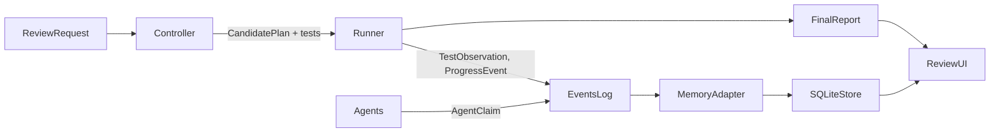

# Shared Contracts

Contract owner and coordinator: **Harsha** (Owner 1). Other owners propose changes in their handoff notes (see `docs/team/README.md`). Nobody changes a contract shape unilaterally.

## Versions

| Version | Status | Meaning |
|---|---|---|
| `migproto.events/v0` | **exists** | What the runner writes today (`events.jsonl`, `summary.json`, plan and tester JSON). There is no version field in the files. Treat any file without `contract_version` as v0. |
| `migproto.contracts/v1` | **proposed** | v0 plus explicit scope fields, outcome types and stable IDs listed below. Additive only: v1 must not remove or rename v0 keys, so existing runs and `examples/` stay readable. |

Every v1 record carries `"contract_version": "migproto.contracts/v1"`.

## Stable IDs

| ID | Format | Status | Source |
|---|---|---|---|
| `run_id` | run directory name, `YYYYMMDD-HHMMSS-<command>`, e.g. `20261017-123652-agent-loop-llm` | exists (directory only, not inside records) | `migproto/runlog.py` |
| `attempt_id` | `<run_id>/a<N>`. `N` is the loop attempt (1-based). The standalone `staged` command is `a1` | proposed | `migproto/agents/loop.py`, `migproto/staged.py` |
| `plan_id` | plan's own id, prefixed by the loop with `a<N>-` (e.g. `a1-rename-note-001`) | exists | `migproto/agents/loop.py::_tag` |
| `stage_id` | plan stage `id` | exists | plan JSON |
| `observation_id` | `<attempt_id>/<check name>#<seq>`, `seq` = 0-based line index in `events.jsonl` | proposed | runner |
| `step` | 0-based index in a check's `steps` array | exists (positional) | `migproto/checks.py::run_case` |
| `claim_id` | `<attempt_id>/<role>/<k>` | proposed | agents |
| `app_version` | `old`, `new-staged`, `new-unsafe` plus pinned commit and patch set, see below | partial | `migproto/config.py::WORKTREES`, `setup` run `worktree` events |

`app_version` note: `git am` re-creates the experimental commits, so their hashes differ between machines. Identify new versions by worktree name plus the SHA-256 of the files in `patches/<version>/`. The old version is `old@0c0e2697cc72aa999f7786ae8aeda7665bd4285f`. Inside check steps, `"app": "old"` means the old version and `"app": "new"` means `new-staged` (for `staged`/`agent-loop`) or `new-unsafe` (for `unsafe`).

## v0 derivation rules (official, deterministic)

Until v1 fields exist, consumers may derive scope from v0 logs **only** with these rules, and must mark such values `"scope_source": "derived_v0"`. Anything not covered here is unknown (`null`). Never guess.

1. `run_id` = name of the directory containing `events.jsonl`.
2. `attempt` = the most recent preceding `{"kind": "attempt"}` event in the same file. Files without attempt events (`unsafe`, `staged`, `baseline`) have exactly one attempt, `a1`.
3. `stage_id` for a check = the most recent preceding `{"kind": "stage"}` event in the same attempt. Checks before the first stage event belong to pseudo-stage `S0` (pre-migration baseline).
4. Schema state after a SQL stage = the `{"kind": "schema"}` event emitted right after it. No schema event is written for `S0`, `deploy_new` or `retire_old`. Schema state there is unknown, not "unchanged".
5. App version for a step = the step's `app` field mapped as described above. Checks without steps (`*.preservation.*`, `*.columns_agree`, `retirement_gate`, `stage.*`) are database-level and have no app version.

## Producer and consumer map



`Controller` is today `migproto/agents/loop.py::run`. `Runner` is `migproto/staged.py::run` plus `migproto/checks.py`. `EventsLog` is `runs/<run_id>/events.jsonl` written through `migproto/runlog.py::RunLog`.

## 1. Review request

| | |
|---|---|
| Status | **proposed**. The scenario is hard-coded today in `migproto/agents/roles.py::SCENARIO` and `migproto/config.py` |
| Producer | UI (Run Review) or CLI |
| Consumer | controller (`migproto/agents/loop.py`) |
| Owner of new fields | Owner 2 (agents) proposes, Harsha approves |

```json
{
  "contract_version": "migproto.contracts/v1",
  "request_id": "req-user-note-rename-001",
  "target": {"app": "saleor", "commit": "0c0e2697cc72aa999f7786ae8aeda7665bd4285f"},
  "change": {
    "description": "Rename Django field User.note (account_user.note, text NULL) to customer_note. Keep the GraphQL field name note.",
    "table": "account_user", "old_column": "note", "new_column": "customer_note",
    "intentionally_introduced": true
  },
  "app_versions": {"old": "old", "new": "new-staged"},
  "mode": "llm",
  "agent_topology": "roles",
  "budget": {"max_revisions": 1, "max_total_tokens": null, "max_model_calls": null, "max_wall_seconds": null}
}
```

`agent_topology` (`single` or `roles`) and the `budget` limits other than `max_revisions` do not exist yet (Owner 2). `max_revisions` is `loop.MAX_REVISIONS = 1` today.

## 2. Candidate plan

| | |
|---|---|
| Status | **exists**, validated by `migproto/plans.py::validate_plan` (unknown keys rejected) |
| Producer | planner role (`migproto/agents/roles.py::plan`) or scripted file (`proposals/scripted/plan_v*.json`) |
| Consumer | runner (`staged.py::run`) |

Allowed keys: `plan_id`, `summary`, `write_consistency`, `revision_notes`, `provenance`, `stages[]`. Stage keys: `id`, `kind` (`sql` / `deploy_new` / `retire_old`), `phase` (`expand` / `backfill` / `contract`, sql only), `description`, `sql[]`, `repeat_until_zero_rows`. Exactly one `deploy_new` and one `retire_old`, at least one `expand` and one `contract` sql stage. Real example (live run, attempt 2, SQL abbreviated, from `examples/live-ordering-revision/plan-a2-a2-rename-note-002.json`):

```json
{
  "plan_id": "a2-a2-rename-note-002",
  "summary": "Add a nullable `customer_note` column and two BEFORE triggers that keep `note` and `customer_note` identical. Backfill existing rows, deploy the new code, retire the old version, then drop the triggers and the old `note` column.",
  "write_consistency": "During the overlap each version writes to its own column; the two BEFORE triggers mirror the change to the other column...",
  "revision_notes": "The previous plan failed because the contract stage (dropping the old column) was executed before the `retire_old` stage...",
  "stages": [
    {"id": "expand-add-column-and-triggers", "kind": "sql", "phase": "expand", "sql": ["ALTER TABLE account_user ADD COLUMN customer_note text", "CREATE OR REPLACE FUNCTION sync_note_to_customer_note() ...", "..."]},
    {"id": "backfill-data", "kind": "sql", "phase": "backfill", "repeat_until_zero_rows": true, "sql": ["WITH batch AS (SELECT id FROM account_user WHERE note IS NOT NULL AND (customer_note IS DISTINCT FROM note) LIMIT 1000) UPDATE account_user SET customer_note = note FROM batch WHERE account_user.id = batch.id"]},
    {"id": "deploy_new", "kind": "deploy_new"},
    {"id": "retire_old", "kind": "retire_old"},
    {"id": "contract-drop-old-column", "kind": "sql", "phase": "contract", "sql": ["DROP TRIGGER ...", "ALTER TABLE account_user DROP COLUMN note"]}
  ]
}
```

The doubled `a2-a2-` prefix is a v0 artifact (the model echoed the prefix). `_tag` now strips existing prefixes. Missing for v1 (Owner 2): `solution_origin` (`generated` / `selected` / `scripted`), `parent_plan_id` for revisions.

Tester proposal (also exists, `plans.py::validate_tests`): `{"checks": [catalogue ids], "custom_cases": [{"id", "description", "steps": [{"app", "op", "user", "value"}]}], "rationale"}`. Custom cases are added to the mandatory catalogue. They can never remove or replace it.

## 3. Execution request

| | |
|---|---|
| Status | **implicit**. Today a Python call `staged.run(log, plan, tests, provenance)` (the CLI `staged` command wraps it) |
| Producer | controller |
| Consumer | runner |
| Owner | Harsha (stable interface is task 2 in `docs/team/01-runner.md`) |

```json
{
  "contract_version": "migproto.contracts/v1",
  "attempt_id": "20261017-123652-agent-loop-llm/a2",
  "plan": {"plan_id": "a2-rename-note-002", "stages": ["..."]},
  "tests": {"checks": [], "custom_cases": ["..."]},
  "provenance": "agent:gpt-oss:120b-cloud",
  "app_versions": {"old": "old", "new": "new-staged"},
  "start_state": {"template_db": "migproto_seed", "seed_checksum": null}
}
```

`start_state.seed_checksum` is not recorded today. Every attempt clones the same `migproto_seed` template, but runs on different machines or after `--rebuild-seed` are not proven equivalent (`populatedb` data is random). Owner: Harsha.

## 4. Test observation

| | |
|---|---|
| Status | **exists** as `{"kind": "check"}` lines written by `RunLog.check` |
| Producer | runner only (`checks.py`, `staged.py`, `unsafe.py`, `baseline.py`) |
| Consumer | agents (as feedback), memory adapter, UI |

Real v0 example (live run, attempt 1, line 22 of `examples/live-ordering-revision/events.jsonl`):

```json
{"t": 43.187, "kind": "check", "provenance": "manual", "name": "case.old_write_new_read", "status": "PASS",
 "steps": [
   {"app": "old", "op": "write", "user": "A", "value": "old wrote this", "user_pk": 240, "ok": true, "error": null},
   {"app": "new", "op": "read", "user": "A", "user_pk": 240, "ok": true, "value": "old wrote this", "error": null}]}
```

Here `provenance: manual` means the case definition came from the manual catalogue. The execution and verdict always come from the runner. Database-level example: `{"kind": "check", "provenance": "runner", "name": "deploy_new.columns_agree", "status": "PASS", "disagreeing_rows": 0, "examples": []}`.

v0 semantics to know:
- `status` is only `PASS` or `FAIL`. Three different things currently share `FAIL`: (a) a failed assertion, e.g. `case.old_write_new_read`, (b) a runner refusal, e.g. `retirement_gate`, `stage.contract.preconditions`, (c) an execution error, e.g. `stage.<id>.executes` with an `error` field. Whole-command crashes produce `summary.verdict = "ERROR"` and `error.txt` instead.
- In the `unsafe` scenario, checks named `old.read_fails` / `old.write_fails` `PASS` when the old app operation fails. The expectation is in the name only.

v1 additions (owner Harsha):

```json
{"contract_version": "migproto.contracts/v1", "observation_id": "20261017-123652-agent-loop-llm/a1/case.old_write_new_read#22",
 "run_id": "20261017-123652-agent-loop-llm", "attempt_id": "20261017-123652-agent-loop-llm/a1", "plan_id": "a1-rename-note-001",
 "stage_id": "deploy_new", "outcome": "pass", "expectation": "succeeds",
 "schema_state": {"columns": ["note", "customer_note"], "triggers": ["trg_sync_customer_note_to_note", "trg_sync_note_to_customer_note"], "django_account_migration": "0107"},
 "app_versions_live": ["old", "new-staged"], "definition_provenance": "manual", "executed_by": "runner"}
```

`outcome` ∈ `pass`, `fail`, `refused`, `error`, `skipped`. `expectation` ∈ `succeeds`, `fails`.

## 5. Agent claim

| | |
|---|---|
| Status | **unstructured**. Claims exist as free text in `agents/<role>.json`: investigator `findings[]`, planner `write_consistency` / `revision_notes`, tester-report `summary` / `suspected_cause` |
| Producer | agents |
| Consumer | memory store, UI, next planner call (feedback) |
| Owner | Owner 2 produces, Owner 3 stores, Harsha approves shape |

Real v0 example (`examples/live-ordering-revision/agents/tester-report-1.json`):

```json
{"summary": "The migration plan a1-rename-note-001 ran three stages—expand, backfill, and deploy_new—successfully... The halt occurred at the contract stage \"contract-drop-old-column\" because the system detected that the old application was still running... No explicit check failures were reported, though the retirement_gate check is listed without details.",
 "suspected_cause": "Old application still running, causing the contract-drop-old-column stage to refuse the column removal."}
```

The claim "listed without details" is accurate about the feedback, not about the run. `loop._feedback` forwards only `name/steps/error/examples` of failed checks, so the gate's `msg` and `old_alive` fields were dropped (Harsha: forward all fields).

v1 shape. Claims never carry their own pass/fail. They reference observations.

```json
{"contract_version": "migproto.contracts/v1", "claim_id": "20261017-123652-agent-loop-llm/a1/tester-report/0",
 "role": "tester", "kind": "diagnosis",
 "text": "Old application still running, causing the contract stage to refuse the column removal.",
 "evidence": ["20261017-123652-agent-loop-llm/a1/retirement_gate#39"],
 "provenance": "agent:gpt-oss:120b-cloud", "model_call": {"seconds": 0.9, "total_tokens": 629}}
```

## 6. Progress event

| | |
|---|---|
| Status | **exists**. Every non-check line in `events.jsonl` |
| Producer | runner, controller |
| Consumer | UI (live progress), memory adapter |

Kinds in use: `stage`, `schema`, `attempt`, `attempt_result`, `agent_config`, `tool`, `investigator_score`, `observation` (runner notes that are not pass/fail, e.g. `retired_old_after_contract`, `old.anonymous_shop_query`), `scenario`, `command`, `worktree`, `patch`, `seed_step`, `seed_ready`, `seed_reused`, `summary`. Common keys: `t` (seconds since the command started, relative), `kind`, `provenance`. Real example:

```json
{"t": 26.31, "kind": "schema", "provenance": "runner", "stage": "expand-add-column-and-triggers", "note_columns": ["note", "customer_note"], "triggers": ["trg_sync_customer_note_to_note", "trg_sync_note_to_customer_note"]}
```

Missing for v1 (Harsha): absolute timestamp, `run_id`, `attempt_id`, and a streaming hook (callback or tail-able file contract) for live UI updates. Today the UI can only tail `events.jsonl`.

## 7. Final report

| | |
|---|---|
| Status | **exists** as `summary.json` written by `RunLog.summary` |
| Producer | runner (`cli._run`) |
| Consumer | UI, memory adapter, REPORT authors |

Real v0 example (abbreviated from `examples/live-ordering-revision/summary.json`):

```json
{"command": "agent-loop-llm", "verdict": "PASS", "elapsed_s": 88.2, "checks_total": 71, "checks_failed": ["retirement_gate"],
 "ok": true, "source": "llm", "provenance": "agent:gpt-oss:120b-cloud",
 "investigator": {"precision": 1.0, "recall": 0.875, "false_negatives": ["saleor/graphql/account/mutations/base.py:182"]},
 "attempts": [
   {"attempt": 1, "plan_id": "a1-rename-note-001", "ok": false, "halted": "contract stage contract-drop-old-column refused: old app still running", "failed_checks": ["retirement_gate"]},
   {"attempt": 2, "plan_id": "a2-a2-rename-note-002", "ok": true, "halted": null, "failed_checks": []}],
 "revision_exercised": true, "revision_fixed_failures": true}
```

v0 semantics: `verdict` reflects the **final** attempt. `checks_total` / `checks_failed` aggregate **all** attempts, so a passing loop still lists attempt-1 failures. Verdict values: `PASS`, `FAIL`, `ERROR`, plus `REPRODUCED` / `NOT_REPRODUCED` for `unsafe`.

Missing for v1: `contract_version`, `run_id`, per-attempt check counts, `model` + `budget` + summed token usage (Owner 2, tokens are only in `agents/transcript-*.json` today), `incomplete` verdict for budget exhaustion (Owner 2), app version and patch hashes (Harsha).

## Gap register

| # | Gap | Owner |
|---|---|---|
| G1 | No `run_id` / `attempt_id` / `plan_id` / `stage_id` on check records (v0 derivation rules above) | Harsha |
| G2 | `FAIL` conflates assertion failure, refusal and execution error. No `expectation` field | Harsha |
| G3 | No schema snapshot for `S0`, `deploy_new`, `retire_old` | Harsha |
| G4 | Start-state equivalence not recorded (seed checksum, worktree heads, patch hashes) | Harsha |
| G5 | Feedback to planner drops check fields (`msg`, `old_alive`) | Harsha |
| G6 | No review request object. Scenario hard-coded | Owner 2 (propose), Harsha |
| G7 | Agent claims are free text without evidence references | Owner 2 |
| G8 | Token usage and latency only in transcripts. No budget enforcement, no `incomplete` outcome | Owner 2 |
| G9 | No single-agent topology to compare with the role loop | Owner 2 |
| G10 | No storage or query layer for observations and claims | Owner 3 |
| G11 | No controller API callable by a UI (only CLI) | Harsha (runner API), Owner 2 (controller) |
| G12 | `agent_config` lacks checkpoint revision, serving backend and version, hardware, sampling settings | Owner 2 |
| G13 | No NeMo Gym episode, trajectory or score record shape | Harsha |
